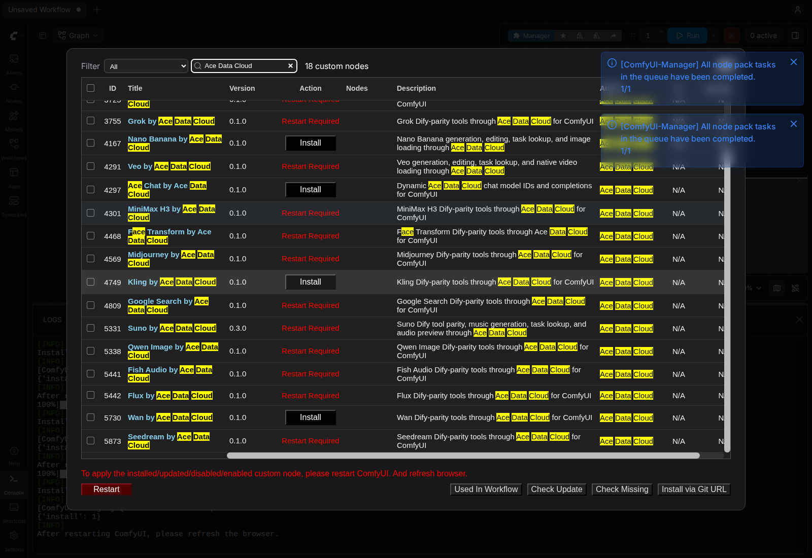
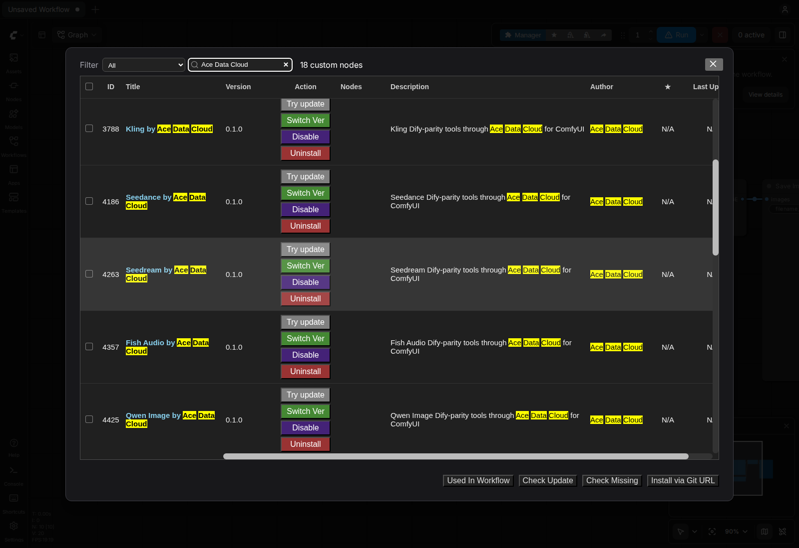

# Ace Data Cloud 的 ComfyUI Wan 节点

按所选动作生成Wan视频，并查询同一个已接受任务。独立节点包调用云API，无需本地模型或显卡；收费前确认自己的权限、余额和当前价格。

[English guide](../README.md)

## 官方安装

打开官方 [Wan by Ace Data Cloud Registry页面](https://registry.comfy.org/nodes/wan)，或在 **Manager → Custom Nodes Manager** 搜索 **Wan**；核对下述Ace发布者/源码，找不到时再搜 **Ace Data Cloud**。选择 **Wan by Ace Data Cloud**，核对发布者 **acedatacloud** 和源码仓库 [`AceDataCloud/WanComfyUI`](https://github.com/AceDataCloud/WanComfyUI)，再点击 **Install**。在 **Select Version** 版本对话框明确选择已批准的 Registry 稳定版 **0.1.0**；普通对话框可能默认高亮 **nightly**，本教程不要直接接受该选项。保留依赖自动安装。出现 **Restart Required** 后重启 ComfyUI，并刷新浏览器。Registry ID 为 `wan`。

这条 Registry 稳定版安装路径已于 **2026-10-16 在原版 Linux CPU ComfyUI 0.41.0** 验证；该次安装验收没有提交生成或聊天请求。更新的宿主版本及每个收费动作仍需分别验证，模型可用性与价格以当前服务规则为准。





以上为 **2026-10-16 Linux ComfyUI0.41.0** 原图，不是新服务词实拍或收费请求；见[来源与限制](screenshot-sources.json)。

## 获取 API Key

### 复制或创建自己的 API Token

注册/登录Ace后打开**应用 → 通用应用**；无通用应用时先初始化。复制有本服务权限的已有Token，或用**管理Key → 创建**单独命名为`ComfyUI`。先核权限、有效期/允许API、Credits余额与当前价格。


以上是 **2026-10-08** SunoDify中的真实脱敏原图，第二图的示例名`Dify tutorial`在此改为`ComfyUI`，本次未创建Key。Token只配置在**实际启动ComfyUI的进程环境**`ACEDATACLOUD_API_KEY`中并重启；节点没有图示的Key输入框，不要填到prompt/JSON/工作流/截图。另一个终端的export不能配置已运行的Desktop进程。

1. 登录 [Ace Data Cloud → 应用](https://platform.acedata.cloud/console/applications?utm_source=comfyui&utm_medium=referral&utm_campaign=evergreen&utm_content=wancomfyui_readme_zh_cn_api_key)。新账户没有通用应用时，先选择**初始化通用应用**。
2. 打开**通用应用**，确认已开通本节点使用的服务。单服务应用的 Key 只限该服务。可复制已有 API Key；需要独立 Key 时，选择**管理 Key → 创建**，命名为 `ComfyUI`。
3. 只复制 Token 字符串，不加 `Bearer ` 或引号。平台管理 Token 不能代替节点调用 API 的 Key。若启用**允许的 API**限制，需同时包含工作流用到的提交和任务查询路径；收费动作前核对当前价格与 Credits 余额。


终端启动时在同一私有终端配置Token再启动：

```bash
export ACEDATACLOUD_API_KEY='在此粘贴自己的Token'
python main.py --cpu
```

在**实际 ComfyUI 进程环境**中设置 `ACEDATACLOUD_API_KEY`（也接受 `ACEDATACLOUD_API_TOKEN`），不要写进工作流或仓库。每个 Dify 工具对应一个节点；model/action 选择器覆盖 Dify YAML 的固定选项，其他字段有具名输入框，留空则省略。数组/对象字段在输入框填 JSON 字符串；高级参数也可放进 `parameters_json` JSON 对象，非空具名字段优先。选 `(from JSON/default)` 则使用 JSON 或 API 默认值。任务查询节点可填 `task_id`，批量查询节点可填 `ids_json`。完整字段和 model 列表见[英文主文档](../README.md)。

导入 [01-configure-and-run.json](../examples/01-configure-and-run.json)，先填任务 ID 或 JSON 参数再运行。提交成功不代表媒体完成；用同一个任务 ID 查询至 `succeeded`，把 Ace CDN URL 接到相应 `VIDEO` 节点。收费提交失败时不会自动重试，先查请求记录和价格。删除/归档类动作仍需在 JSON 明确设置 `confirm: true`。详见[隐私说明](PRIVACY.md)。

## 同任务刷新与取消限制

导入收费提交图前关闭自动队列/自动运行，明确只提交一次。本版未实现任务缓存刷新hook或可中断轮询回调；同输入查询仍返回旧pending时，改`wait_seconds`（如240改239）并**只查同一任务ID**以失效缓存，不要重跑生成。Stop可能需等轮询/HTTP超时，不撤销或退款远端已接受任务；`wait_seconds=0`可用于显式单次状态查询。不要把Top5的独立运行时修复当成本包已具备。

## 排错

| 现象 | 处理 |
| --- | --- |
| 缺Key/401 | 配实际启动进程的API Token并重启；管理Token不能替代API Key |
| 403 | 读具体权限/有效期/允许路径或内容限制原因，不盲目重发 |
| 429 | 等限流恢复，保留已接受任务ID，不重复付费提交 |
| JSON/模型/字段无效 | 按工具字段修正，示例`{}`/URL只是占位 |
| 超时/5xx | 再付费提交前查控制台请求/Trace记录 |
| 结果或媒体异常 | 按本服务同步/异步说明检查；pending不冒充成品 |
